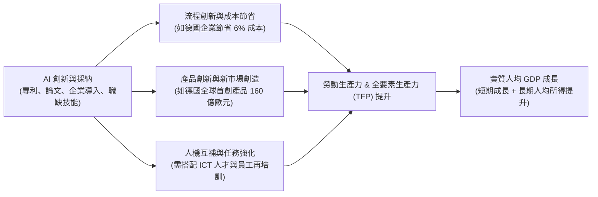

# 概念綜合：AI 對生產力（TFP／勞動生產力）與經濟成長之影響機制

本頁面綜合知識庫中所有探討「AI 採納／創新如何影響生產力與總體經濟成長」的理論與實證發現，直接提供本研究 **假設一（H1：AI 採納與經濟成長呈正向關係）** 之文獻支撐。

---

## 一、 理論傳導機制（Theoretical Mechanisms）

結合本研究架構與實證文獻，AI 影響總體經濟成長（實質人均 GDP 成長率）主要透過三條核心管道：

1. **自動化與效率提升（Automation & Efficiency）**：AI 取代或輔助例行性與認知型工作任務，提高單位勞動時間產出（勞動生產力）。
2. **降低生產與營運成本（Cost Reduction）**：如[德國 CIS 企業調查](../sources/src-germany-growth-adoption-innovation.md)所示，AI 支援的流程創新占德國企業部門年度總成本節省的 **6%**；[IMF 歐洲生產力研究（2025）](../sources/src-eu-oecd-productivity-and-growth.md)亦將「潛在勞動成本節省」作為推估 TFP 成長的核心來源。
3. **促進知識創造與首創創新（Knowledge Creation & Innovation）**：AI 不僅是生產工具，更是「發明的方法（Method of Invention）」。在德國，使用 AI 與全球首創產品創新每年約 **160 億歐元**銷售額相關（占全球首創創新總銷售額 **18%**）。

---

## 二、 實證效果量級彙整（Magnitude of Impacts）

### 1. 對全要素生產力（TFP）的影響
- **國際文獻綜整（[丹麥央行報告, 2026, Table 1](../sources/src-denmark-skills-productivity-labor.md)）**：綜合多篇國際研究，AI 預計每年可提升 TFP 成長率約 **0.1 至 1.2 個百分點**。
- **丹麥情境模擬（[丹麥央行報告, 2026, Chart 8](../sources/src-denmark-skills-productivity-labor.md)）**：依丹麥工作任務暴露度估計，AI 每年可提升丹麥 TFP 成長約 **0.1 至 1.0 個百分點**。
- **歐洲 31 國中期估計（[IMF Working Paper, 2025](../sources/src-eu-oecd-productivity-and-growth.md)）**：在最佳情境下，AI 可在 **5 年內使歐洲整體 TFP 累積提升約 1%**（但若計入嚴格監管法規，該潛在增幅可能縮減 **30% 以上**）。

### 2. 對勞動生產力（Labor Productivity）的影響
- **微觀企業職缺實證（[丹麥 Research Policy, 2026](../sources/src-denmark-skills-productivity-labor.md)）**：企業職缺中 Data Science & AI 技能需求占比每增加 **10 個百分點**，企業勞動生產力約有 **0.63%** 的顯著正向增幅；且 AI 技能對 TFP 的拉動效果強於一般數位技能。
- **歐洲跨國企業實證（[Chief Economists WP, 2026](../sources/src-eu-oecd-productivity-and-growth.md)）**：分析 2021–2025 年歐洲資料，固定效果模型顯示企業 AI 採用率與勞動生產力呈顯著正相關。

### 3. 對總體 GDP 與人均所得（短期 vs. 長期）的影響
- **短期與長期動態（[Notas Económicas, OECD 35 國 Panel ARDL, 2026](../sources/src-eu-oecd-productivity-and-growth.md)）**：以專利衡量的 AI 採用（1995–2017），在**短期對經濟成長率有顯著正向貢獻**，在**長期則顯著提升均衡人均所得水準**。
- **直接與間接效果（[EU27 Conference Paper, 2024](../sources/src-eu-oecd-productivity-and-growth.md)）**：
  - AI 綜合指標（`AI_PCA`，整合 AI 研究排名、新創數量與知識交流）對 EU27 的 GDP 成長與勞動生產力皆有顯著正向直接影響。
  - **中介機制**：AI 技術可透過**先提升勞動生產力，進而間接促進 GDP 成長**；反觀單純的「數位普及（Digital Inclusion）」雖能提升勞動生產力，卻無直接推升 GDP 的顯著效果。

---

## 三、 重要研究限制與口徑辨析（Caveats for Literature Review）

> [!IMPORTANT]
> 在撰寫本研究之文獻回顧時，必須明確區分以下三個方法論細節：
> 1. **舊型 AI（Old AI）vs. 生成式 AI（GenAI）**：
>    - 涵蓋 2021 年以前資料的研究（如 [OECD 微觀資料擴散研究](../sources/src-eu-oecd-productivity-and-growth.md)、[EU27 2010–2020 研究](../sources/src-eu-oecd-productivity-and-growth.md)、[OECD 1995–2017 專利研究](../sources/src-eu-oecd-productivity-and-growth.md)）衡量的是傳統機器學習、專家系統與工業自動化 AI。
>    - 2022 年底以後的文獻（如 [CEPR 2026 短期成長研究](../sources/src-eu-oecd-productivity-and-growth.md)、[2025–2026 企業採用調查](../sources/src-eu-oecd-productivity-and-growth.md)）則開始捕捉生成式 AI 對知識密集型服務業的衝擊。
> 2. **「廣泛採用（Any Use）」vs.「顯著／核心使用（Significant Use）」**：
>    - [歐元區 2025 年企業調查](../sources/src-eu-oecd-productivity-and-growth.md)揭示，雖然高達 **70%** 企業表示有使用 AI，但僅 **7%** 自評為「顯著使用」。這解釋了為何表面採用率高，但總體 TFP 增幅在短期內仍呈現溫和累積（如 IMF 估計 5 年累積約 1%）。
> 3. **模型推估（Model-based Simulation）vs. 實際觀測（Observed Data）**：
>    - [IMF（2025）](../sources/src-eu-oecd-productivity-and-growth.md)與[丹麥央行（2026）](../sources/src-denmark-skills-productivity-labor.md)的部分 TFP 預測屬於基於職業任務暴露度的「事前模型推估」，而非事後實際觀測到的總體生產力躍升。本研究採用 OECD 實質人均 GDP 與專利面板資料，能提供更具事後觀測基礎的實證檢驗。

---

## 四、 相關頁面（Related Pages）

- **全局與國別頁面**：[研究全局綜述](../overview.md) | [德國](../countries/germany.md) | [荷蘭](../countries/netherlands.md) | [丹麥](../countries/denmark.md) | [歐盟與 OECD](../countries/eu-oecd.md)
- **其他概念專題**：
  - [跨國異質性與調節變數分析（H2 & H3）](country-heterogeneity-and-moderators.md)
  - [AI 與產業創新及國際貿易出口績效](ai-innovation-and-trade.md)
  - [文獻計量方法比較與本研究變數對齊](methodology-and-variables.md)
